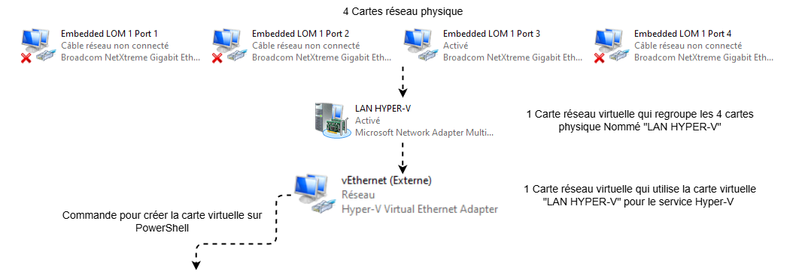

## Divers

### Création d'une carte réseau virtuelle pour Hyper-V  


  Il faut d'abord créer un commutateur virtuel **LAN HYPER-V** dans **Gestionnaire de serveur > Serveur local > Association de cartes réseau**.


Schéma explicatif :  



``` PowerShell
New-VMSwitch -Name "Externe" -NetAdapterName "LAN HYPER-V" -AllowNetlbfoTeams $true -AllowManagement $true
```